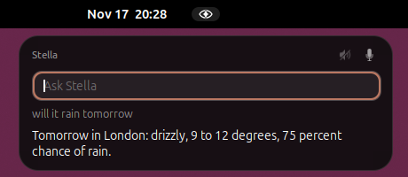
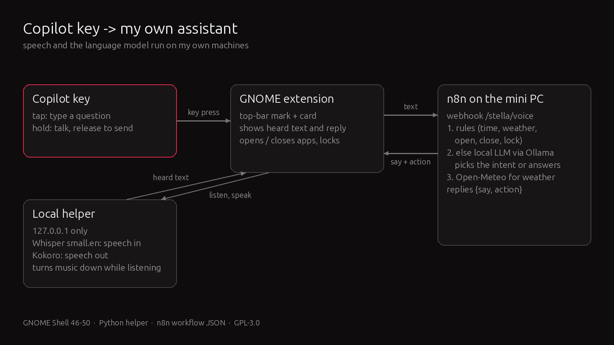
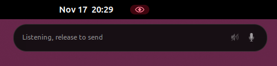
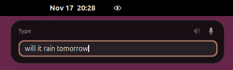
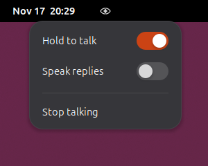

# Stella

The Copilot key on new laptops opens nothing useful on Linux. This turns it into a small assistant of my own:
tap it to type a question, hold it to talk. The answer comes from an n8n workflow running on a mini PC at home,
with a local model through Ollama.





## What it does

- **Tap** the Copilot key (or click the mark in the top bar): a card opens under the bar, type and press Enter.
- **Hold** it: push to talk. Release and the speech is transcribed by Whisper on the laptop, then sent on.
- The n8n workflow answers. Cheap rules handle the time, the weather, opening and closing apps and locking the
  screen. Anything else goes to a local model, which either picks one of those or just answers.
- Desktop actions run on the laptop: the reply carries an `action` and the extension opens the app, closes its
  windows or locks the screen.
- Replies can be spoken with Kokoro. Right-click the mark to turn speech or hold-to-talk off.
- If Stella asks something back ("Close what?"), the next answer is taken as the reply.

| Listening | Typing | Menu |
|---|---|---|
|  |  |  |

## Parts

| Folder | What it is |
|---|---|
| `extension/` | GNOME Shell extension: the top-bar mark, the card, the Copilot key binding, desktop actions |
| `helper/` | `stella_helper.py`, a small HTTP service on 127.0.0.1:8098: mic recording, Whisper, Kokoro |
| `n8n/` | `stella-voice.json`, the workflow to import, and `build_flow.py`, which generates it |
| `tests/` | checks that the workflow is wired, the wake-word clean-up, and that no personal details are in the tree |

## Install

Needs GNOME Shell on Wayland, PipeWire, Python 3.10+, and an n8n you can reach (same machine or another one on your
network) with Ollama next to it.

```sh
./install.sh
```

That copies the extension, makes a venv for the helper in `~/.local/share/stella`, downloads the Kokoro model
(about 340 MB) and starts `stella-helper.service` as a user unit. Then:

1. In n8n, import `n8n/stella-voice.json`. Open the **Settings** node and set the Ollama URL, the model
   (`ollama pull qwen3:8b` or anything that can return JSON) and your town and coordinates. Publish it.
2. If n8n runs on another machine, point the extension at it in `~/.config/stella/config.json`:
   ```json
   {"n8n": "http://<mini-pc>:5678/webhook/stella/voice"}
   ```
3. Log out and back in, then `gnome-extensions enable stella@023b.github.io`.

If the Copilot key does nothing, check what it sends with `wev` or `libinput debug-events`. On the laptops I
know it is Super+Shift+F23. The extension also grabs `XF86Assistant` and Super+Shift+`XF86TouchpadOff`, which
some keyboards send instead.

## How the key is read

GNOME only reports that an accelerator was pressed, not when it was released. The Copilot key keeps Super and
Shift held for as long as it is down, so after the press the extension polls the modifier state every 30 ms.
Under 320 ms is a tap; longer is a hold, and the moment the modifiers go up is the release.

## Adding to the workflow

Edit `n8n/build_flow.py`, run `python3 n8n/build_flow.py`, and import the JSON again. Or edit in the n8n canvas
directly; the flow is small: Understand (rules) -> LLM router if no rule matched -> Intent switch -> one branch
per intent -> Reply. A new intent needs a rule or a line in the router prompt, a branch, and a link to Reply.

## Honest limits

- Tested on GNOME Shell 50 (Ubuntu). The metadata allows 46 to 50, untested there.
- The rules are English only and simple. Everything else depends on how good your local model is.
- On a CPU-only mini PC, a cold model load takes a minute or more; once loaded, an 8B model answered in about
  10 seconds on mine. Rule answers (time, weather, apps) come back straight away.
- The hold-to-talk end-of-speech detection in hands-free mode is a plain energy gate, so a loud room can keep it
  listening until the 12 second limit.
- Weather comes from Open-Meteo, so that one question does go out to the internet.

## Licence

GPL-3.0-or-later. Kokoro is used through `kokoro-onnx`, which pulls in espeak-ng (GPL).
