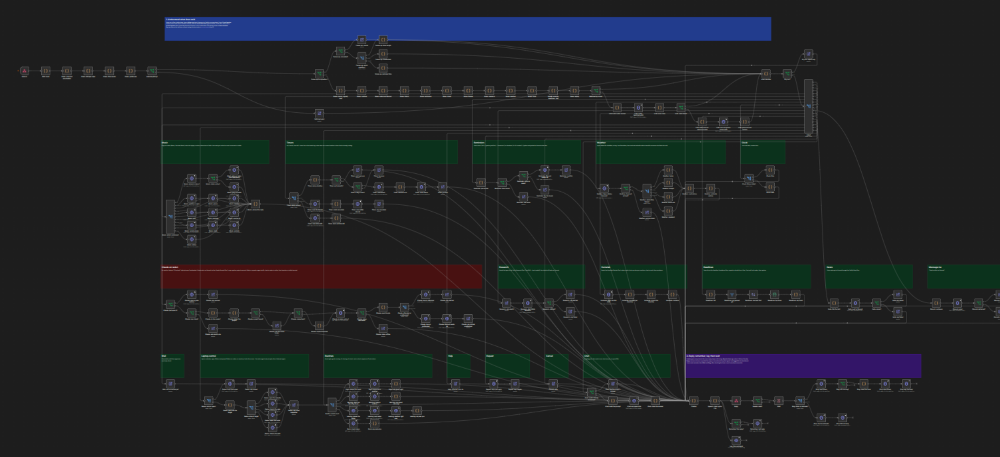

# The full flow

`stella-voice-full.json` is the workflow I actually use every day, with my own details taken out. 225 nodes:
every decision is its own node, so an execution reads on the canvas step by step.

**Understand.** Four clean-up steps (case, Whisper's usual slips, filler words, "could you please"), a follow-up
check for answers to Stella's own questions, then 12 rule families. If no rule fires, a local router model
(gemma4:e4b, JSON, few-shot) picks the intent, with a second opinion from qwen3:8b when the first answer is not
valid. Every route meets at **Intent decided**.

**Act.** One block per intent: music, timers, reminders, weather, clock, Claude Code on the laptop, research,
homelab, deadlines, notes, Discord, mail, calendar, laptop control, routines (good night, I'm leaving, I'm back,
study and coding layouts), help, repeat, cancel, chat.

**Reply.** Same reply shape from every branch, cleaned up for speech, answered at once. The reply is remembered
for "say that again" and logged; timers and reminders then wait and ring.

## What it needs

The rule, weather, clock, deadline and chat branches work on their own. The rest call a small "hands" HTTP
service next to n8n (`http://host.docker.internal:8097`, header `X-Token`), which is not in this repo because
mine is tied to my own machines. If it is missing, those branches answer "... did not answer" and nothing hangs.
Its endpoints, if you want to write your own:

| Endpoint | Used for |
|---|---|
| `/kv` | timers, last reply (get and set JSON) |
| `/say` | speak a line on the mini PC when a timer rings |
| `/music` | play, pause, next, volume |
| `/status`, `/laptop/do`, `/laptop/job`, `/laptop/claude` | is the laptop online, open/close/lock, start Claude Code |
| `/board` | show a reminder on the laptop |
| `/host` | is a machine or service up |
| `/mail`, `/calendar` | read-only mail headers and calendar |
| `/ctl`, `/log` | wake word on/off, command log |

Before using it: replace `CHANGE_ME_HANDS_TOKEN`, put your own projects in **Claude: match the project** and
**Laptop: work out the target**, your dates in **Deadlines: list**, and your town in the weather nodes.

Send `{"text": "...", "dry": true}` to see which intent and rule a sentence gets without anything happening.

Note: the timer branch says "Timer set" even when the hands service is missing, but nothing will ring.
